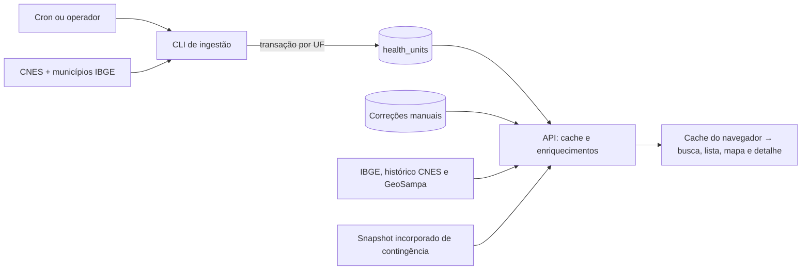
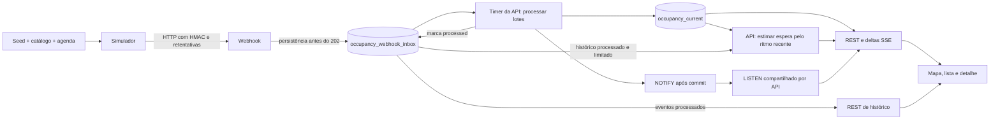

# Fluxo do FilaSaúde

Este guia descreve a implementação atual. [Regras e limites](behavior-reference.md)
detalha os cálculos; o [runbook](operations.md) cobre diagnóstico e recuperação.
As [ADRs](adr/0004-occupancy-inbox-processing.md) registram as decisões.

## Processos e responsabilidades

| Componente | Onde executa | Quando trabalha |
| --- | --- | --- |
| Ingestão CNES | CLI NestJS em processo separado | Cron semanal ou execução manual |
| API HTTP | Serviço `api` | Requisições cadastrais, webhook, REST e SSE |
| Processador de ocupação | Dentro de cada processo da API | Timer, por padrão a cada 2 segundos |
| Listener de ocupação | Dentro da API, com conexão dedicada do pool | Quando a exposição pública está habilitada, mesmo sem visitantes |
| Simulador nacional | Serviço `simulator`, perfil Compose `simulation` | Agenda própria por unidade; independe dos visitantes |
| Frontend | Navegador; arquivos servidos pelo serviço `web` | Navegação, consultas e assinatura SSE |
| Backup | Script chamado pelo cron do servidor | Agendamento operacional, separado do deploy |

“Processador independente” significa independente da requisição do webhook;
não existe um contêiner exclusivo para ele no Compose atual.

## Cadastro: da fonte ao navegador

A ingestão coleta UFs independentemente, faz upsert por CNES e desativa os
registros ausentes apenas após uma coleta completa. Uma UF com falha preserva
o catálogo anterior; outras UFs podem ser atualizadas e a CLI ainda termina
com erro. O script de produção impede execuções simultâneas por `flock` e usa
a imagem do último deploy confirmado.

A API lê o banco, com cache por UF e visão nacional. A visão nacional exige
presença de todas as UFs. Falha ou catálogo incompleto leva à última resposta
válida marcada como desatualizada ou ao snapshot incorporado. O endpoint
principal do CNES não é consultado nesse caminho; enriquecimentos geográficos
ainda podem consultar fontes externas. A precedência das posições, suas
atribuições e limitações está nas ADRs [0001](adr/0001-public-health-unit-data-source.md)
e [0002](adr/0002-additional-public-data-sources.md).

Correções administrativas têm autenticação própria e histórico de autoria.
Invalidam o cache da UF e da visão nacional na instância que atende à alteração;
a interface administrativa também limpa seu cache cadastral local. Não há
invalidação distribuída desses caches entre réplicas ou navegadores.

## Ocupação: da geração à tela

O simulador seleciona o catálogo no início, gera capacidades e ocupações
fictícias e assina o corpo serializado. O [README do simulador](../apps/simulador/README.md#como-a-seed-gera-a-ocupação)
explica a geração determinística; o [contrato do webhook](contracts/occupancy-snapshot-v1.md)
define autenticação, autorização por CNES, validação e duplicidade.

`202 Accepted` confirma recebimento persistido, não aplicação na tela. A inbox
é simultaneamente a fila de entrada e a origem do histórico processado; não há
uma tabela separada de histórico de ocupação. O processador aplica somente
eventos mais novos ao estado atual. Um evento atrasado continua no histórico e
notifica os clientes mesmo sem alterar o estado atual.

A espera estimada é calculada pela API, não pelo simulador. Essa separação
permite que cada unidade implemente somente o envio das contagens pelo contrato,
sem precisar calcular e enviar análises prontas. Recebimento, histórico,
processamento analítico e metodologia comum ficam no FilaSaúde; o simulador
exercita a mesma fronteira como fornecedor dos dados. A API lê o histórico
processado de um conjunto de unidades em uma consulta limitada e ancora a janela
na versão do estado atual já capturada. Infere os inícios pela variação dos
concluídos e das pessoas em atendimento e divide a fila atual por esse ritmo.
REST e deltas SSE recebem o mesmo `waitEstimate`; o detalhe recebe o mesmo campo
em `data.current`. Capacidade instalada e serviços são dados opcionais do cenário
simulado, separados da estimativa. Decisão e limites: [ADR 0008](adr/0008-operational-indicators-and-wait-estimation.md)
e [contrato da estimativa](contracts/wait-estimate-v1.md).

O navegador consulta REST para sincronizar e recebe deltas SSE enquanto a camada
está ligada e a página visível. Reconexões recompõem o estado por REST, sem
replay durável nem polling como contingência. O detalhe recarrega o histórico
quando seu CNES recebe atualização. A [ADR 0003](adr/0003-occupancy-server-sent-events.md)
explica as garantias do canal.

## Controles que não se equivalem

| Controle | Efeito |
| --- | --- |
| `OCCUPANCY_SIMULATION_ENABLED=true` na API | Expõe REST/SSE públicos e inicia o listener; não inicia o simulador |
| `OCCUPANCY_PROCESSOR_ENABLED=false` na API | Desliga o timer e sua limpeza; webhook pode continuar acumulando eventos |
| Perfil Compose `simulation` | Permite iniciar o serviço gerador |
| Interruptor da camada no navegador | Controla visualização/assinatura daquela sessão; não para ingestão nem geração |

Publicação também é independente: push na `main` executa CI; produção exige o
workflow manual de deploy. Imagens, migrations, confirmação e rollback estão
no [guia de deploy](deployment.md#4-publicação-e-rollback). Rollback de imagem
não reverte migrations.
