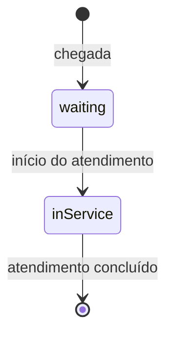

# Contrato `occupancy.snapshot.v2`

O v2 estende o [`occupancy.snapshot.v1`](./occupancy-snapshot-v1.md) com um
objeto opcional `attendance`: pessoas esperando, pessoas em atendimento e
atendimentos concluídos em um período. O schema normativo está em
[`occupancy-snapshot-v2.schema.json`](./occupancy-snapshot-v2.schema.json).

Cabeçalhos, assinatura, idempotência por `eventId`, limites e respostas de erro
são os mesmos do v1. O endpoint também é o mesmo: `POST /webhooks/v1/occupancy`
recebe as duas versões, distinguidas pelo campo `type`. Um snapshot v1 continua
válido e significa que a fonte não informa o fluxo de atendimento.

Refs #107, #108, #109 e #110.

## Estados e transições

Cada pessoa passa por três estados: chega, espera e é atendida, até sair.



- `waiting`: pessoas aguardando o início do atendimento no instante observado.
  Não há uma contagem pública separada de triagem.
- `inService`: pessoas com atendimento em curso no instante observado.
- `completed.count`: atendimentos concluídos no período informado, acumulados
  até o instante observado.
- `serviceSlots`: quantos atendimentos a unidade sustenta ao mesmo tempo agora.
  É a referência da espera (pessoas esperando por posto); não é teto da fila,
  e `inService` pode ultrapassá-lo por pouco tempo quando os postos diminuem.

Os estoques seguem:

```text
waiting   = waiting anterior   + chegadas  - iniciados
inService = inService anterior + iniciados - concluídos
```

`waiting` e `inService` são estoques do momento; `completed` é volume de um
período. As três dimensões são independentes de `categories`: pessoas em
atendimento não são somadas aos leitos ocupados, e a capacidade de atendimento
não é deduzida da quantidade de leitos. Uma pessoa atendida pode depois ocupar
um leito, mas o contrato não relaciona as duas contagens.

## Campos

| Campo | Tipo | Regra |
| --- | --- | --- |
| `type` | string | Exatamente `occupancy.snapshot.v2`. |
| `attendance` | objeto | Opcional, com ao menos um campo. Campos desconhecidos são rejeitados. |
| `attendance.waiting` | inteiro ≥ 0 | Opcional. |
| `attendance.inService` | inteiro ≥ 0 | Opcional. |
| `attendance.serviceSlots` | inteiro ≥ 1 | Opcional. Postos de atendimento simultâneo ativos agora. |
| `attendance.completed` | objeto | Opcional; exige `count`, `periodStart` e `periodEnd`. |
| `attendance.completed.count` | inteiro ≥ 0 | Total acumulado no período, não pessoas únicas. |
| `attendance.completed.periodStart` | ISO 8601 | Início do período, incluído. |
| `attendance.completed.periodEnd` | ISO 8601 | Fim do período, excluído; posterior a `periodStart`. |

Os demais campos e regras são os do v1. O instante das contagens atuais é
`observedAt`; a fonte é o cabeçalho `X-Webhook-Source`; a marca de simulação é
dada pela API em todas as respostas de ocupação.

### Zero e ausência

Campo ausente significa não informado. `0` significa que a fonte confirmou
zero pessoas ou zero conclusões. `null` não é aceito. Como o snapshot é
completo, um snapshot mais recente sem um desses campos faz o valor passar a
“não informado”; ele nunca é lido como zero.

### Período dos concluídos

O período é semiaberto, `[periodStart, periodEnd)`, e `occurredAt` deve estar
dentro dele. O simulador usa o dia civil de Brasília, com deslocamento fixo
`-03:00` para todas as unidades (o Brasil não adota horário de verão desde
2019), por exemplo `2026-10-23T00:00:00-03:00` a `2026-10-24T00:00:00-03:00`.
Unidades em outros fusos usam a mesma convenção nacional nesta demonstração.

`count` é cumulativo dentro do período. O consumidor guarda o valor do snapshot
mais recente de cada unidade e período, pelo `observedAt`, e nunca soma valores
de snapshots diferentes. Por isso:

- reenvios e retentativas do mesmo `eventId` não duplicam o total;
- um snapshot atrasado não substitui um total mais recente do mesmo período;
- na virada do período, a contagem recomeça em um novo `periodStart`;
- se a fonte reiniciar, ela informa o que conhece desde o reinício; o
  consumidor substitui o valor, sem somar e sem inventar o que se perdeu.

## Exemplo válido

```json
{
  "eventId": "01K5T2S6C4TZ1K9TR6F89A2M7X",
  "type": "occupancy.snapshot.v2",
  "unitCnes": "1234567",
  "occurredAt": "2026-10-23T14:30:00-03:00",
  "observedAt": "2026-10-23T14:30:05-03:00",
  "categories": [
    { "code": "observation", "capacity": 20, "occupied": 13 }
  ],
  "attendance": {
    "waiting": 7,
    "inService": 4,
    "serviceSlots": 4,
    "completed": {
      "count": 86,
      "periodStart": "2026-10-23T00:00:00-03:00",
      "periodEnd": "2026-10-24T00:00:00-03:00"
    }
  }
}
```

## Limites

As contagens são agregadas e não identificam pacientes. Elas não estimam tempo
de espera, não classificam gravidade e não recomendam unidades. No simulador,
são hipóteses da demonstração, descritas no
[README do simulador](../../apps/simulador/README.md#fluxo-de-atendimento-sintético).
