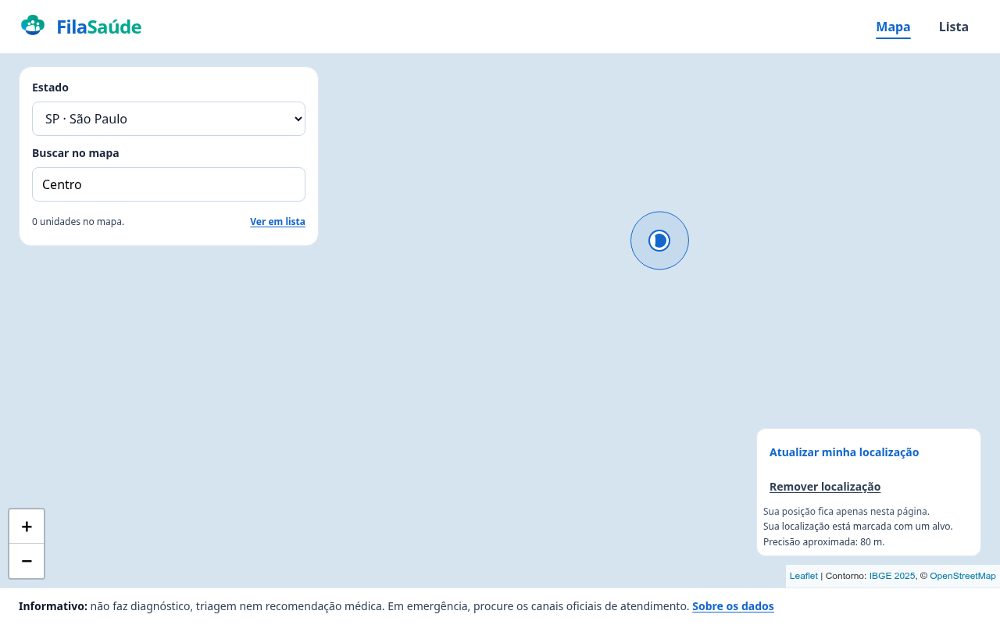
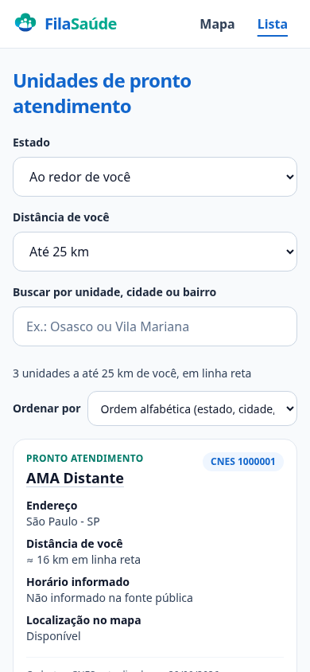
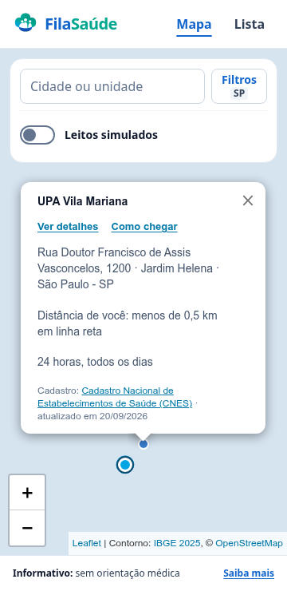
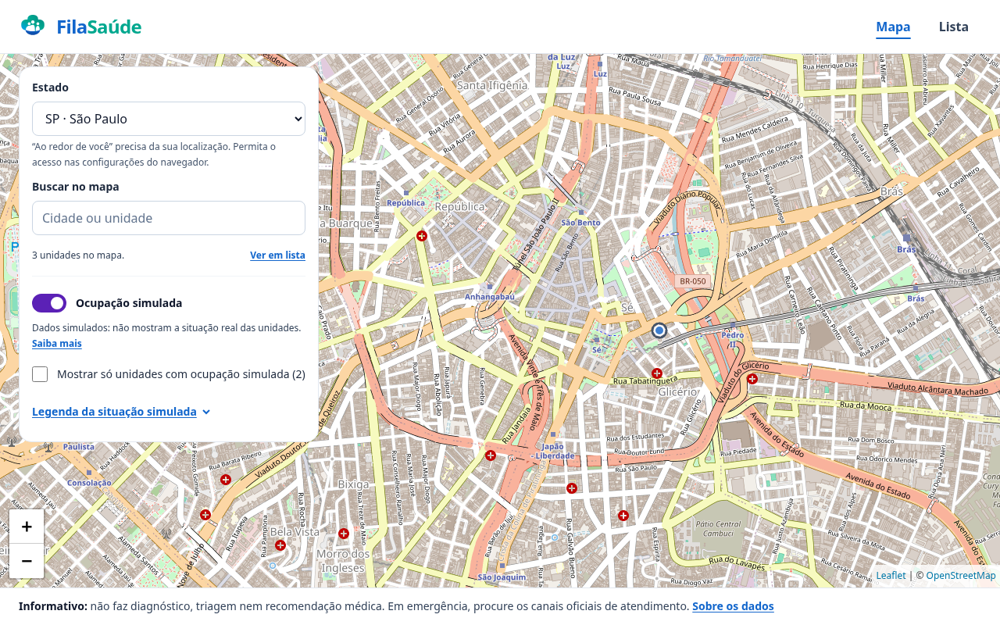
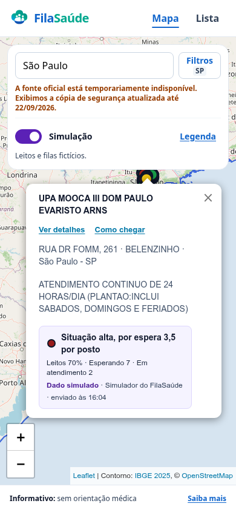
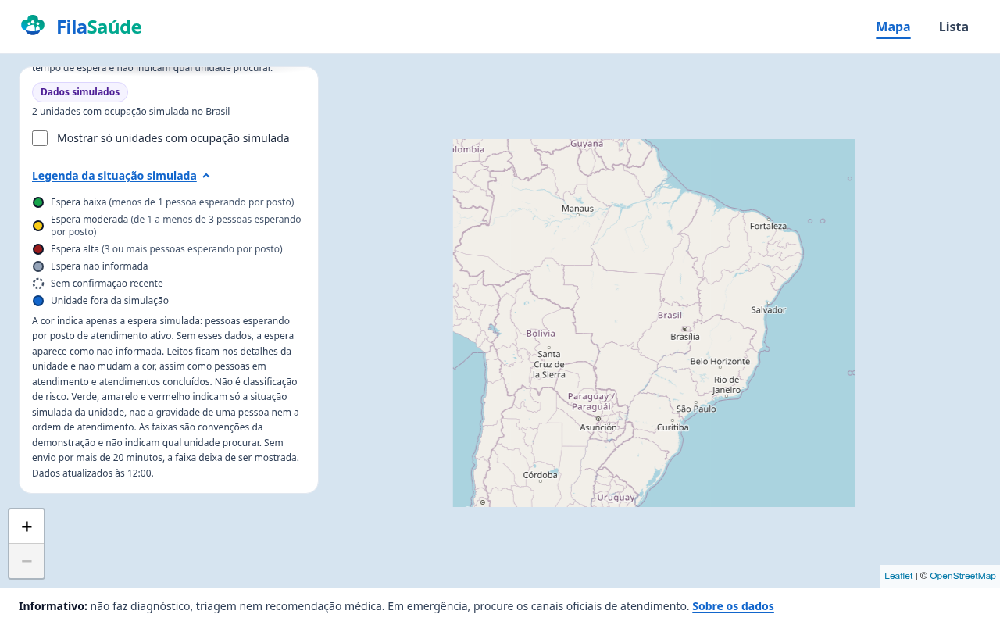
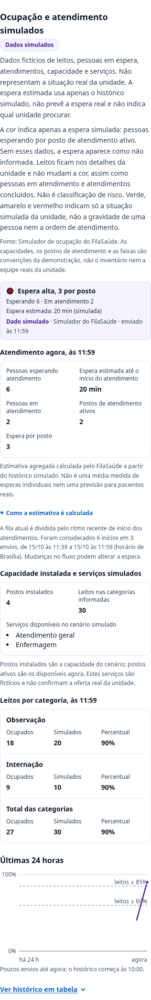
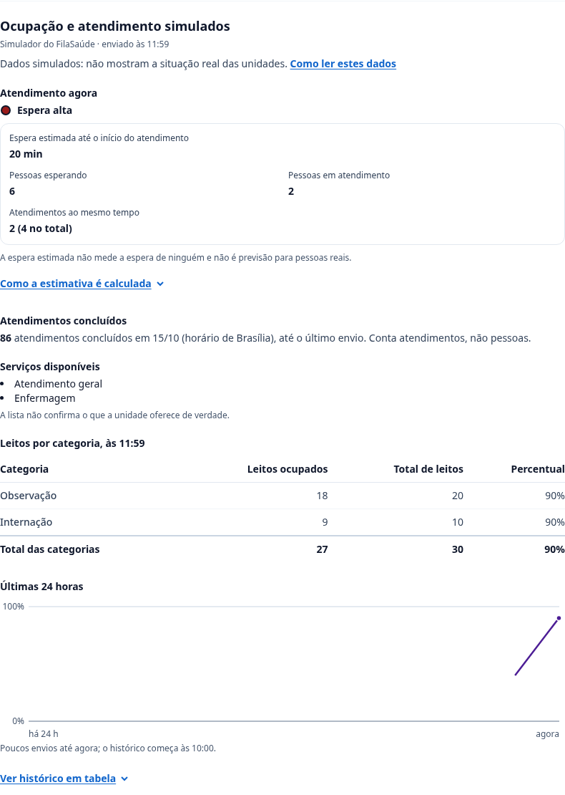

# Guia do FilaSaúde

Este guia explica o FilaSaúde sem termos técnicos. A primeira parte apresenta o
projeto: o problema, a proposta, de onde vêm os dados e o que o site não faz. A
segunda parte mostra como usar o site, passo a passo.

Para os detalhes de implementação, consulte o [README](../README.md) e as
[decisões de arquitetura](adr/).

## Parte 1 — O projeto

### O que é

O FilaSaúde é um site que reúne, em um mapa e em uma lista, as unidades públicas
de pronto atendimento do SUS de todo o Brasil: UPAs, prontos-socorros e prontos
atendimentos. Para cada unidade, mostra o nome, o tipo, o endereço, a
localização no mapa e o horário informado, sempre com a fonte e a data de
atualização do dado.

É um Projeto Integrador do eixo de Computação da UNIVESP (Universidade Virtual do Estado de São Paulo).

### O problema

A pergunta que guia o projeto é:

> Como facilitar a consulta de informações sobre unidades públicas de pronto
> atendimento disponíveis em determinada região?

As informações sobre essas unidades já são públicas: o Ministério da Saúde as
publica no CNES. Mas o CNES foi feito para quem administra o sistema de saúde,
com códigos e telas de consulta pouco práticas. Para quem só quer saber "qual é
a UPA mais perto de mim e em que horário ela atende?", é difícil achar a
resposta lá.

### A proposta

O FilaSaúde busca esses dados públicos, organiza e apresenta de forma simples:

- **um mapa** como porta de entrada, para ver as unidades da região;
- **uma lista** com as mesmas informações, que funciona bem com teclado e
  leitor de tela;
- **a fonte e a data** de cada informação, para que a pessoa saiba de onde ela
  veio e se pode estar desatualizada;
- **um canal de integração** para que os sistemas das unidades informem a
  ocupação e a fila em tempo real.

O site não pede cadastro, senha nem dados pessoais.

### De onde vêm as informações

- **CNES** (Cadastro Nacional de Estabelecimentos de Saúde), do Ministério da
  Saúde: nome, tipo, endereço, horário e coordenadas de cada unidade. O
  FilaSaúde atualiza essa base toda semana.
- **IBGE**: o contorno do Brasil e dos municípios, usado para conferir se a
  posição de cada unidade faz sentido.
- **GeoSampa**, da Prefeitura de São Paulo: ajuda a confirmar a posição das
  unidades da capital paulista.

As coordenadas do CNES são informadas pelas próprias unidades, e algumas caem
longe do município certo. Por isso, o FilaSaúde confere cada ponto. Quando a
posição não é confiável, ele usa uma posição anterior do cadastro ou, em último
caso, o centro do município, e avisa isso na tela. Nenhuma unidade é escondida
por causa da posição.

Se o cadastro oficial estiver fora do ar, o site continua funcionando com uma
**cópia de segurança** e mostra um aviso com a data dessa cópia.

### A integração com as unidades e a ocupação simulada

Não existe hoje uma fonte pública nacional que informe, em tempo real, quantos
leitos estão ocupados ou quantas pessoas estão esperando em cada unidade. Quem
tem essa informação são os sistemas das próprias unidades e das secretarias de
saúde.

Por isso, a ideia central do FilaSaúde é oferecer **um canal de integração
pronto** para que esses sistemas enviem a situação de cada unidade de forma
simples. Esse canal é um *webhook*: um endereço na internet para o qual o
sistema da unidade manda uma mensagem sempre que a situação muda ou, no mínimo,
a cada poucos minutos. O FilaSaúde recebe, guarda e mostra no mapa.

O canal já vem padronizado, para que a integração seja rápida e confiável:

- **Formato combinado**: a mensagem segue um modelo publicado, com os mesmos
  campos para todas as unidades. Basta o sistema preencher o modelo, sem
  adaptações caso a caso.
- **Segurança**: cada sistema autorizado tem uma chave própria e "assina" as
  mensagens, para que ninguém consiga enviar dados em nome de uma unidade.
- **Tolerância a falhas**: se a conexão cair e o sistema reenviar a mesma
  mensagem, ela não é contada duas vezes. Uma mensagem atrasada também não
  apaga uma informação mais nova.
- **Sem dados de pacientes**: o canal só aceita números agregados, como
  "7 pessoas esperando", nunca nomes ou informações de saúde de alguém.

O modelo inclui:

- **leitos ocupados** e a capacidade (observação, estabilização e internação);
- **pessoas esperando** atendimento;
- **pessoas em atendimento** e quantos postos de atendimento estão ativos;
- **atendimentos concluídos no dia**;
- **postos instalados** e **serviços disponíveis no cenário simulado**.

Como nenhuma unidade está conectada ainda, um programa do próprio projeto, o
**simulador**, faz o papel dos sistemas das unidades. Ele usa exatamente o mesmo
canal que uma unidade real usaria e envia números inventados. Assim é possível
demonstrar a plataforma funcionando de ponta a ponta. Essa **demonstração com
dados fictícios** só aparece para quem ligar a opção no site.

O simulador acompanha cada pessoa fictícia pelos estados chegada → espera →
atendimento → saída. As contas sempre fecham: quem começa a ser atendido sai da
espera, e quem termina o atendimento libera o posto para o próximo. Assim a fila
cresce quando chega mais gente do que a unidade consegue atender e diminui
quando sobra capacidade. As chegadas e as conclusões são sorteadas, por isso o
ritmo oscila. Os sorteios podem ser reproduzidos nos testes, mas o FilaSaúde não
usa os parâmetros internos do simulador para calcular a espera.

Com a demonstração ligada, cada unidade ganha uma cor:

| Cor | Situação | Quando aparece |
| --- | --- | --- |
| Verde | Espera baixa | Fila menor que a capacidade de atendimento |
| Amarelo | Espera moderada | Fila de 1 a menos de 3 vezes a capacidade |
| Vermelho | Espera alta | Fila de 3 vezes a capacidade ou mais |

A capacidade é quantas pessoas a unidade atende ao mesmo tempo no cenário
simulado. A cor compara só a fila com essa capacidade. Sem a quantidade de
pessoas esperando ou sem a capacidade informada, aparece **"Espera não
informada"** em cinza. Zero pessoas esperando é diferente de dado ausente.

O resumo no mapa e na lista destaca pessoas esperando e em atendimento. A
ocupação de leitos fica como informação complementar nos detalhes da unidade:
mesmo com leitos cheios, ela não aumenta a faixa de espera. Pessoas em atendimento
e atendimentos concluídos também não mudam a cor. As faixas são convenções da
simulação e não estimam quanto tempo uma pessoa vai esperar.

### Os cinco indicadores operacionais

Com a demonstração ligada, os detalhes da unidade reúnem:

| Indicador | O que mostra |
| --- | --- |
| Pessoas em espera | Quantas pessoas fictícias aguardam o início do atendimento no último envio. |
| Espera estimada | Uma aproximação em minutos, calculada pelo FilaSaúde usando o ritmo recente de início dos atendimentos. |
| Ocupação de leitos | Quantos leitos estão ocupados e o percentual das categorias informadas. |
| Capacidade instalada | Leitos das categorias informadas e postos instalados no cenário; os postos ativos mostram quantos estão disponíveis agora. |
| Serviços disponíveis | Os serviços fictícios do cenário, como atendimento geral e enfermagem. Não confirmam a oferta real da unidade. |

**A fonte envia as contagens; o FilaSaúde calcula a estimativa.** O site compara
os envios guardados para descobrir quantos atendimentos começaram no intervalo.
Depois, divide a fila atual por esse ritmo. Por exemplo: com seis pessoas
esperando e seis atendimentos iniciados nos últimos 20 minutos, a estimativa é
de 20 minutos. Não é preciso que o sistema de origem envie um tempo pronto.

Essa divisão facilita a conexão das próprias unidades: o sistema de cada uma
só precisa enviar os números operacionais que já conhece, sem desenvolver um
cálculo de espera ou mandar uma análise pronta. O **armazenamento do histórico
e o processamento analítico são responsabilidade do FilaSaúde**, que aplica a
mesma metodologia aos dados recebidos e informa quando eles não bastam para
calcular. Assim, o método pode evoluir no FilaSaúde sem exigir uma implementação
nova em cada unidade, enquanto as contagens necessárias forem as mesmas.

O envio das contagens continua sendo necessário. O simulador demonstra essa
integração fazendo o papel de quem fornece os dados; a análise fica na
plataforma que os recebe.

O cálculo usa até uma hora de histórico, com pelo menos três envios cobrindo
15 minutos. Lacunas, mudanças de fonte ou de período e quedas nos contadores
interrompem a série. Enquanto não houver dados suficientes ou ritmo de
atendimento, a estimativa aparece como indisponível; dado ausente não vira zero.
Quando a confirmação vence, ela também deixa de ser mostrada como atual.

A estimativa é **agregada e simulada**: não mede quanto cada pessoa esperou,
não é a duração de uma consulta nem prevê quanto alguém real aguardará.
Mudanças na demanda e critérios clínicos podem mudar a ordem e o ritmo do
atendimento. A estimativa não altera a cor nem a ordem das unidades na lista.

O botão e cada resumo indicam que os dados são simulados, com a fonte
(Simulador do FilaSaúde) e o horário do envio. Os números não descrevem
nenhuma unidade de verdade, e as cores **não são classificação de risco**.

### O que o FilaSaúde não faz

- Não faz diagnóstico, triagem nem avaliação de sintomas.
- Não diz qual unidade procurar nem qual é "a melhor".
- Não prevê a espera real de uma pessoa; a estimativa disponível pertence
  apenas à demonstração com dados simulados.
- Não substitui os canais oficiais de saúde e de emergência.

A ordem dos resultados é alfabética ou por distância, e não indica prioridade.
**Em uma emergência, ligue para o SAMU (192) ou procure os canais oficiais.**

### Privacidade

- O site não tem contas de usuário e não guarda dados pessoais.
- A localização só é usada se a pessoa permitir. Ela fica na memória da aba
  aberta, não é enviada ao servidor do FilaSaúde e não aparece no endereço da
  página.
- "Como chegar" abre o aplicativo de mapas com o destino da unidade; a rota é
  calculada pelo próprio aplicativo.

### Acessibilidade

O mapa é a entrada principal, mas não é o único caminho. A lista traz as mesmas
informações e pode ser usada só com o teclado ou com leitor de tela. A cor nunca
aparece sozinha: há sempre um texto que diz a situação. O site também se adapta
a telas pequenas, a celulares deitados e a fontes maiores.

### Limites e próximos passos

- Os dados cadastrais dependem do CNES: endereço e horário podem ter mudado
  desde a última atualização da unidade.
- Por enquanto, a ocupação e a fila são uma demonstração acadêmica com dados
  fictícios. O canal de integração já está pronto: quando uma unidade ou
  secretaria de saúde se conectar, os dados reais entram pelo mesmo caminho.
  Basta autorizar o sistema dela e ajustar o site, que hoje marca toda a
  ocupação como simulada.
- O ritmo recente pode mudar. A estimativa não detecta um reinício da fonte
  quando o contador volta a crescer sem uma queda observável entre os envios.
- Filtros por características da unidade estão planejados.

## Parte 2 — Como usar

### 1. Abra o mapa

Ao entrar no site, o mapa mostra o Brasil e pede permissão para usar sua
localização. Se você permitir, o mapa se aproxima de onde você está. Se recusar,
pode escolher o estado ou buscar uma cidade normalmente.

### 2. Escolha onde procurar

No painel do mapa (no celular, em **Filtros**):

- **Estado**: mostra as unidades de uma UF ou de todo o Brasil.
- **Ao redor de você**: com a localização permitida, mostra as unidades a até
  5, 10, 25, 50, 100, 250 ou 500 km. A distância é em linha reta, não a do
  trajeto.
- **Buscar**: digite o nome da unidade, a cidade ou o bairro.

### 3. Veja uma unidade

Toque ou clique em um ponto do mapa para abrir o resumo da unidade: nome,
endereço, horário e a fonte do cadastro. Dali você pode:

- **Ver detalhes**: abre a página completa da unidade;
- **Como chegar**: abre o aplicativo de mapas com o destino.

### 4. Use a lista

Em **Lista**, no topo da página, as mesmas unidades aparecem em cartões, em
ordem alfabética ou, com a localização permitida, por distância. Cada cartão
tem **Ver detalhes** e **Ver no mapa**. A busca e o estado escolhidos valem para
o mapa e para a lista.

### 5. Entenda os avisos

| Aviso | O que quer dizer |
| --- | --- |
| "A fonte oficial está temporariamente indisponível" | O site está usando a cópia de segurança, com a data indicada. |
| "Aproximada: centro do município" | A coordenada do cadastro não era confiável; o ponto marca o centro da cidade. |
| "Posição do CNES de (mês)" | A coordenada atual não era utilizável; foi usada uma posição anterior do cadastro. |
| "Posição corrigida manualmente" | A equipe do projeto conferiu e ajustou a posição. |

### 6. Ligue a ocupação simulada (opcional)

No painel do mapa, ligue **Ocupação simulada**. As unidades da demonstração
ganham as cores verde, amarelo e vermelho; as demais continuam em azul.

Ao abrir uma unidade, o resumo mostra a faixa de espera, as pessoas esperando
e as pessoas em atendimento, com fonte e horário do envio. Quando há histórico
suficiente, também aparece **Espera estimada**, em minutos. Leitos, capacidade e serviços ficam nos detalhes da unidade. Dados
ausentes aparecem como não informados.

Em **Legenda da situação simulada** estão as faixas de cada cor. Se uma unidade
fica mais de 20 minutos sem enviar dados, a cor some e aparece "Sem dados
recentes", para que um número antigo não pareça atual.

Na página de detalhes, a seção **Ocupação e atendimento simulados** separa:

- **Atendimento agora**: o nível da espera, a espera estimada, pessoas
  esperando, pessoas em atendimento e quantos atendimentos a unidade faz ao
  mesmo tempo (agora e no total);
- **Como a estimativa é calculada**: toque para ver o método, o intervalo e a
  quantidade de envios considerados;
- **Atendimentos concluídos**: o total do dia, em horário de Brasília;
- **Serviços disponíveis**: os serviços do cenário, que não confirmam a oferta
  real da unidade;
- **Leitos por categoria** e o histórico das últimas 24 horas, em gráfico e em
  tabela.

Se a estimativa estiver indisponível, leia o motivo no próprio detalhe:

| Mensagem | O que significa |
| --- | --- |
| "Não informada" | A versão do FilaSaúde consultada ainda não informa a estimativa. |
| "Indisponível: faltam dados da unidade" | Faltam as contagens necessárias para o cálculo. |
| "Indisponível: ainda há poucos dados para calcular" | Ainda não há uma sequência longa o suficiente de envios compatíveis. |
| "Indisponível: nenhum atendimento começou no período analisado" | O histórico não registra inícios suficientes para calcular um ritmo positivo. |
| "Indisponível: dados desatualizados" | Os dados venceram; a estimativa antiga não é apresentada como atual. |

A demonstração fica ligada só na aba aberta. Para desligar, use o mesmo botão.

### Perguntas frequentes

**Os números de leitos e de espera são reais?**
Não. São fictícios, criados pelo simulador para a demonstração acadêmica, e
aparecem com a fonte "Simulador do FilaSaúde" e o aviso de dados simulados.

**A espera estimada vem do governo ou do simulador?**
É calculada pelo FilaSaúde a partir das contagens recebidas e guardadas no
histórico. Hoje, essas contagens vêm do simulador. Ele faz o papel de um sistema
de origem, mas não envia a estimativa nem fornece ao cálculo seu ritmo interno.

**Por que a estimativa não aparece logo que a demonstração começa?**
O FilaSaúde precisa de histórico suficiente e de um ritmo positivo de início
dos atendimentos. A ocupação de leitos ou o número de postos, sozinhos, não
dizem quanto tempo a fila demora. Uma fila confirmada em zero só resulta em
zero minutos quando existe um ritmo válido para o cálculo.

**Esse tempo diz quanto eu vou esperar?**
Não. É uma aproximação agregada para uma demonstração fictícia. Não é a média
medida das esperas individuais e não é uma promessa de atendimento.

**Vermelho quer dizer que é grave?**
Não. A cor indica só a situação simulada da unidade, não a gravidade de uma
pessoa nem a ordem de atendimento.

**Por que a unidade que eu conheço está no lugar errado?**
A posição vem do cadastro oficial e às vezes está errada. O FilaSaúde avisa
quando usa uma posição aproximada. A equipe pode corrigir posições
manualmente.

**O horário mostrado é garantido?**
É o horário informado pela unidade no CNES. Ele pode ter mudado; confirme com a
unidade quando possível.

**O site sabe onde eu estou?**
Só se você permitir, e só nesta aba. A posição não é enviada ao servidor do
FilaSaúde.
